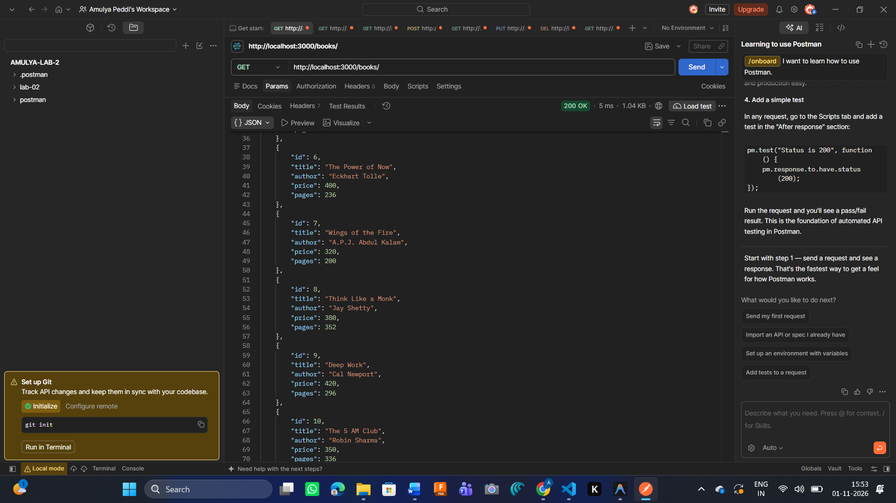
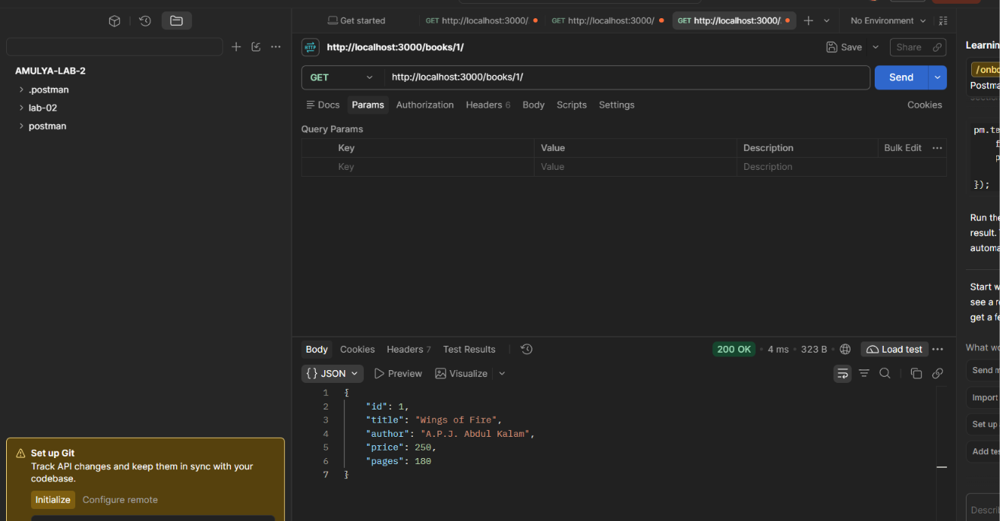
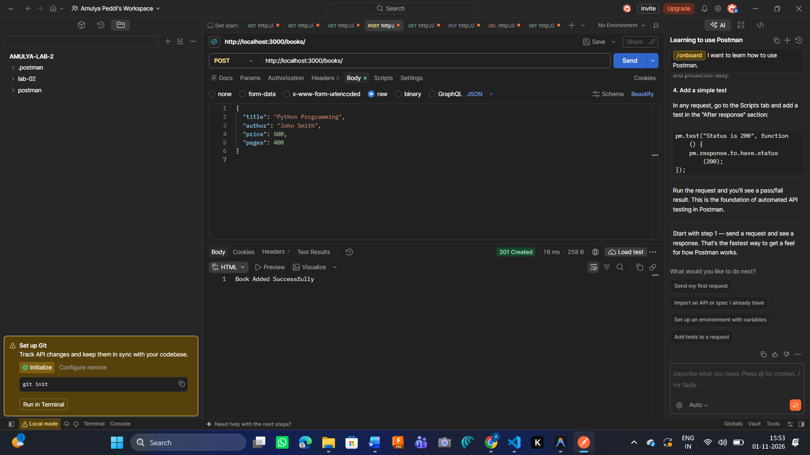
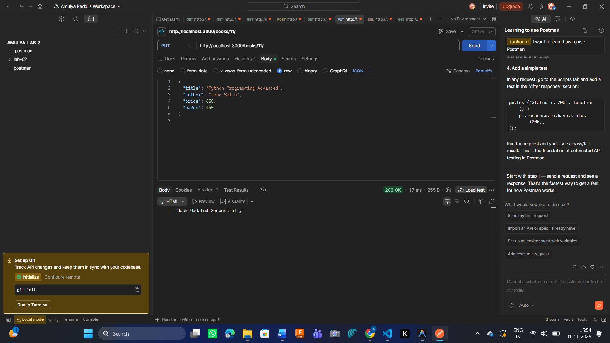
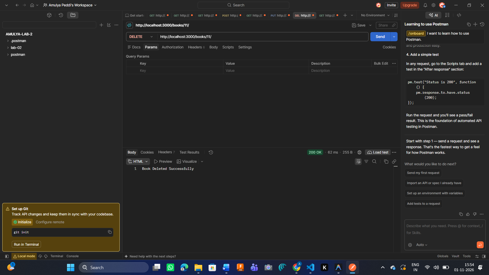
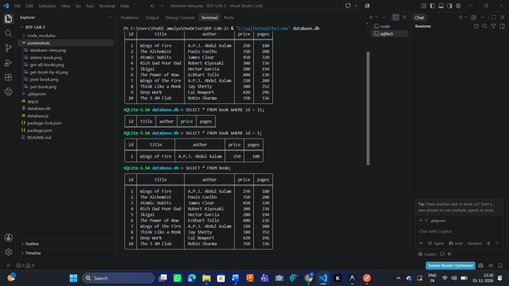

# Lab 2: SQLite Database and CRUD Routes

## Student Details

- **Name:** Amulya Peddi
- **Registration Number:** 252U1R1189
- **Section:** 214
- **Lab:** 02
- **Subject:** Backend Development Fundamentals

## Live Deployment Link

- **Render Live URL:** https://bdf-lab2-yqtx.onrender.com
- **GitHub Repository:** https://github.com/peddiamulya66-prog/BDF-LAB2

## 1. Project Overview

The objective of this lab is to develop a RESTful API using Node.js, Express.js, and SQLite. The application performs CRUD operations (Create, Read, Update, and Delete) on a book database.

The project manages book information such as:

- Book ID
- Book Title
- Author Name
- Price
- Number of Pages

The API allows users to retrieve all books, retrieve a specific book by ID, add new books, update existing book details, and delete books.

## 2. Technologies Used

| Technology | Purpose |
|---|---|
| Node.js | JavaScript runtime environment |
| Express.js | Creating REST API routes |
| SQLite | Database management |
| sqlite3 | SQLite database driver |
| sqlite | Promise-based database operations |
| Nodemon | Automatically restarts the server during development |
| Postman | Testing API endpoints |
| Git and GitHub | Version control and source code hosting |
| Render | Application deployment |

## 3. Project Structure

```text
BDF-LAB-2/
│
├── app.js
├── database.js
├── database.db
├── package.json
├── package-lock.json
├── .gitignore
├── README.md
│
└── screenshots/
    ├── get-all-books.png
    ├── get-book-by-id.png
    ├── post-book.png
    ├── put-book.png
    ├── delete-book.png
    └── database-view.png
```

## 4. Database Design

**Database Name:** SQLite Database

**Table Name:** book

The book table contains the following columns:

| Column | Data Type | Description |
|---|---|---|
| id | INTEGER | Unique book ID and primary key |
| title | TEXT | Name of the book |
| author | TEXT | Name of the author |
| price | INTEGER | Price of the book |
| pages | INTEGER | Number of pages |

The database contains 10 initial book records.

## 5. How to Run the Project

### Prerequisites

Install the following software:

- Node.js
- npm
- Visual Studio Code
- SQLite
- Postman (for API testing)

### Step 1: Clone the Repository

```bash
git clone https://github.com/peddiamulya66-prog/BDF-LAB2.git
```

### Step 2: Navigate to the Project Folder

```bash
cd BDF-LAB-2
```

### Step 3: Install Dependencies

```bash
npm install
```

### Step 4: Start the Application

For development:

```bash
npm run dev
```

For normal execution:

```bash
npm start
```

### Step 5: Access the API

The local server runs at:

```text
http://localhost:3000
```

To retrieve all books:

```text
http://localhost:3000/books/
```

### Environment Variables

No environment variables are required for the current local configuration.

The application uses port 3000 and connects to the SQLite database file `database.db`.

## 6. API Endpoints

The application provides five REST API endpoints.

| HTTP Method | Endpoint | Description |
|---|---|---|
| GET | `/books/` | Retrieves all books |
| GET | `/books/:bookId/` | Retrieves a book using its ID |
| POST | `/books/` | Adds a new book |
| PUT | `/books/:bookId/` | Updates an existing book |
| DELETE | `/books/:bookId/` | Deletes a book |

### 6.1 GET – Retrieve All Books

**Endpoint:**

```http
GET /books/
```

**Description:** Retrieves all records from the book table.

**Expected Response:** HTTP 200 OK with a JSON array of books.

### 6.2 GET – Retrieve a Book by ID

**Endpoint:**

```http
GET /books/1/
```

**Description:** Retrieves the details of a specific book using its ID.

**Expected Response:** HTTP 200 OK if the book exists, otherwise HTTP 404 Not Found.

### 6.3 POST – Add a New Book

**Endpoint:**

```http
POST /books/
```

**Request Body:**

```json
{
  "title": "Python Programming",
  "author": "John Smith",
  "price": 500,
  "pages": 400
}
```

**Description:** Adds a new book record to the database.

**Expected Response:** HTTP 201 Created.

### 6.4 PUT – Update Book Details

**Endpoint:**

```http
PUT /books/11/
```

**Request Body:**

```json
{
  "title": "Python Programming Advanced",
  "author": "John Smith",
  "price": 650,
  "pages": 450
}
```

**Description:** Updates the details of an existing book using its ID.

**Expected Response:** HTTP 200 OK if the record is updated successfully.

### 6.5 DELETE – Delete a Book

**Endpoint:**

```http
DELETE /books/11/
```

**Description:** Deletes a book record using its ID.

**Expected Response:** HTTP 200 OK if the record is deleted successfully.

## 7. Screenshots

The following screenshots demonstrate the execution and testing of the API endpoints.

### 7.1 GET All Books



### 7.2 GET Book by ID



### 7.3 POST – Add a New Book



### 7.4 PUT – Update Book



### 7.5 DELETE – Delete Book



### 7.6 SQLite Database View



## 8. Problems Faced and Solutions

### Problem 1: SQLite Database Connection

**Problem:** Initially, connecting to the SQLite database and executing queries required proper configuration.

**Solution:** Used the `sqlite` and `sqlite3` packages to establish an asynchronous database connection and execute SQL queries.

### Problem 2: Server Deployment Failure on Render

**Problem:** The initial deployment failed because the SQLite3 native module required a Linux GLIBC version that was not available in the Render environment.

**Solution:** Updated the SQLite3 dependency to version 5.1.7, updated the package files, committed the changes, and pushed them to GitHub. The new Render deployment completed successfully.

### Problem 3: Testing API Endpoints

**Problem:** Understanding how to test GET, POST, PUT, and DELETE requests was initially challenging.

**Solution:** Used Postman and the browser to test API routes and verify responses.

### Problem 4: Database Record Verification

**Problem:** It was necessary to confirm whether database changes were correctly reflected after CRUD operations.

**Solution:** Used SQLite CLI commands to inspect the book table and verify database records.

## 9. Key Learnings

Through this lab, I learned:

- How to create and connect an SQLite database using Node.js.
- How to create REST API routes using Express.js.
- How to perform CRUD operations using SQL queries.
- How to use parameterized queries with `?` placeholders.
- How to handle asynchronous database operations.
- How to test APIs using Postman.
- How to use Git and GitHub for version control.
- How to deploy a Node.js application using Render.
- How to identify and resolve deployment errors.

## 10. Conclusion

This lab helped me understand the practical implementation of database connectivity and REST API development using Node.js, Express.js, and SQLite.

I successfully developed five CRUD API endpoints to manage book records, tested the API functionality, and deployed the application on Render.

The project improved my understanding of backend development, database operations, API testing, debugging, and application deployment.

---

**Project Status:** Successfully deployed on Render.

**GitHub Repository:** https://github.com/peddiamulya66-prog/BDF-LAB2